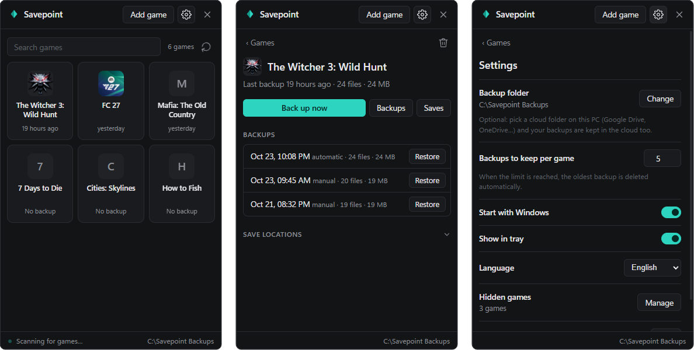

<p align="center">
  
</p>

<h1 align="center">Savepoint</h1>

<p align="center">
  Automatic, versioned backups of your PC game saves.<br>
  Small, quiet and free. <b>Windows 10 and 11.</b>
</p>

<p align="center">
  <a href="https://github.com/eneskocamaan/savepoint/releases/latest"></a>
  <a href="https://github.com/eneskocamaan/savepoint/actions/workflows/ci.yml"></a>
  
  <a href="LICENSE"></a>
</p>

<p align="center"><a href="README.tr.md">Türkçe</a> · <a href="https://github.com/eneskocamaan/savepoint/releases/latest">Download</a> · <a href="CONTRIBUTING.md">Contributing</a></p>

<p align="center">
  
</p>

Savepoint sits in the notification area and does nothing while you play. When you close a game, it looks at that game's save files and, if anything changed, keeps a new copy. If a save ever gets corrupted, or you want to go back to an earlier point, you restore it with one click.

Choose a Google Drive, OneDrive or Dropbox folder as the backup folder and your saves are in the cloud too, and can be restored on another PC.

## Download

From the **[latest release](https://github.com/eneskocamaan/savepoint/releases/latest)**:

| File | What it is |
|---|---|
| `Savepoint-<version>-windows-x64-setup.exe` | **Recommended.** Installs for your Windows user only (no admin rights), adds a Start menu entry and, if you want, starts with Windows. Includes an uninstaller. |
| `Savepoint-<version>-windows-x64-portable.zip` | No installation. Unzip anywhere and run `savepointd.exe`. |
| Source code (zip / tar.gz) | Added by GitHub to every release. |

There is nothing to set up: on first start Savepoint downloads the game list, finds your games and opens its window. Backups go to `Documents\Savepoint Backups` until you choose another folder.

> **Windows SmartScreen** may say "Windows protected your PC" because the files are not code-signed yet. Click *More info → Run anyway*. You can check that a download is the published one by comparing `Get-FileHash <file>` in PowerShell with `SHA256SUMS.txt` from the release.

The window uses Microsoft Edge WebView2, which comes with Windows 11 and up-to-date Windows 10. The installer tells you if it is missing.

## Features

- **Finds your games by itself.** Save locations for over 20,000 games come from the community-maintained [Ludusavi Manifest](https://github.com/mtkennerly/ludusavi-manifest). Installed games are found through Steam, the Epic Games launcher, GOG Galaxy, the Xbox app, the programs registered in Windows (installers and repacks included) and common game folders. Copies running on a Steam emulator are recognised by their `steam_appid.txt` and the emulator's own save folders.
- **Backs up when you close a game.** No schedule and no scanning while you play: Windows reports when a game comes to the foreground, and Savepoint waits for it to exit.
- **Only when something changed.** Size and date are compared first and contents (BLAKE3) only when needed. Files that did not change are hard-linked to the previous backup instead of copied again.
- **Safe restore.** Before anything is overwritten, the window shows how many files will be written and which of them changed since that backup, and the current saves are backed up first, so a restore can always be undone.
- **Damaged-save protection.** If a save file comes out empty or much smaller than before (a typical result of a crash), the backup is flagged, you get a warning, and the last good backup is never deleted by the automatic clean-up.
- **Move to another PC.** Files are stored relative to folders like Documents or AppData, not to your user name, so a backup can be restored on a PC with a different user name or Steam library.
- **Tells you when something is wrong.** A failed backup (disk full, unreachable backup folder, a save locked by another program) shows a red bar instead of failing silently.
- **Light.** About 2 MB of memory and no measurable CPU while idle (measured on the author's PC). The window is a separate program that only runs while it is open.
- **English, Turkish and Spanish.** Adding a language means translating one file, see [CONTRIBUTING.md](CONTRIBUTING.md#translations).

Games it does not know can be added by hand with **Add game** (a name, the save folder, and optionally the game's exe for its icon and automatic backups).

## Privacy

- No account, no telemetry, no ads.
- The only network access is downloading the game list from GitHub (`raw.githubusercontent.com`) at most once a week, using Windows' own `curl.exe`.
- Settings, the game list cache and a small log live in `%LOCALAPPDATA%\Savepoint`. Backups go only where you choose.

## Questions

**Where are my backups and what do they look like?**
Plain folders, readable without Savepoint: `<backup folder>\<game>\<date-time>\` with the save files and a `backup.json` describing them. Use *Backups* on a game's page to open its folder.

**How many backups are kept?**
10 per game by default (change it in Settings). When a new one is made, the oldest is deleted, except the last backup that was not flagged as damaged.

**My game is not in the list.**
Press the refresh button next to the search box, or start and close the game once (its save folder may not exist before that). If it is still missing, add it with *Add game*.

**How do I open Savepoint if I hid the tray icon?**
Start it again from the Start menu (or run `savepointd.exe`); the running copy opens its window.

**Does uninstalling delete my backups?**
No. The uninstaller removes the program only. Your backups and `%LOCALAPPDATA%\Savepoint` stay.

## How it works

| Part | Job | Runs |
|---|---|---|
| `savepointd.exe` | Tray icon, game detection, backup queue, local named-pipe server | Always, without a window |
| `savepointd.exe --scan` | Downloads and reads the game manifest, finds games on this PC | Weekly, when the list is older than 10 minutes and the window is opened, or on demand, as a short-lived child process |
| `savepoint-ui.exe` | The window ([Tauri](https://tauri.app) with plain HTML, CSS and JavaScript) | Only while open |

```
crates/savepoint-core   engine: manifest, game detection, backup, restore
crates/savepoint-ipc    UI <-> service protocol (one JSON line per request)
crates/savepointd       background service
ui/src-tauri            window (Rust side)
ui/web                  window contents, translations in ui/web/lang
installer               Inno Setup script
```

## Building from source

Requires Windows 10/11, [Rust](https://rustup.rs) 1.90 or newer with the MSVC toolchain (Visual Studio Build Tools with "Desktop development with C++"), and optionally [Inno Setup 6](https://jrsoftware.org/isinfo.php) for the installer. Node.js is not needed.

```powershell
cargo build --release          # target\release\savepointd.exe and savepoint-ui.exe
cargo test --workspace         # tests
.\scripts\package.ps1          # dist\: portable zip, installer, SHA256SUMS.txt
```

Run `target\release\savepointd.exe` to start it. More details in [CONTRIBUTING.md](CONTRIBUTING.md).

## Known limitations

- Windows only.
- Saves stored in the Windows registry (some older games) are not backed up.
- Detection through GOG Galaxy and the Xbox app has had little real-world testing so far; reports are welcome.
- The release files are not code-signed yet (see the SmartScreen note above).

## Contributing

Bug reports, ideas, translations and pull requests are welcome. Please read [CONTRIBUTING.md](CONTRIBUTING.md) and the [Code of Conduct](CODE_OF_CONDUCT.md). Security issues: see [SECURITY.md](SECURITY.md).

## Credits

- Game save locations: [Ludusavi Manifest](https://github.com/mtkennerly/ludusavi-manifest) by mtkennerly, built from [PCGamingWiki](https://www.pcgamingwiki.com).
- Window: [Tauri](https://tauri.app). The full list of libraries and their licenses ships with every release as `THIRD-PARTY-LICENSES.txt`.

## License

[MIT](LICENSE) © 2026 eneskocamaan
